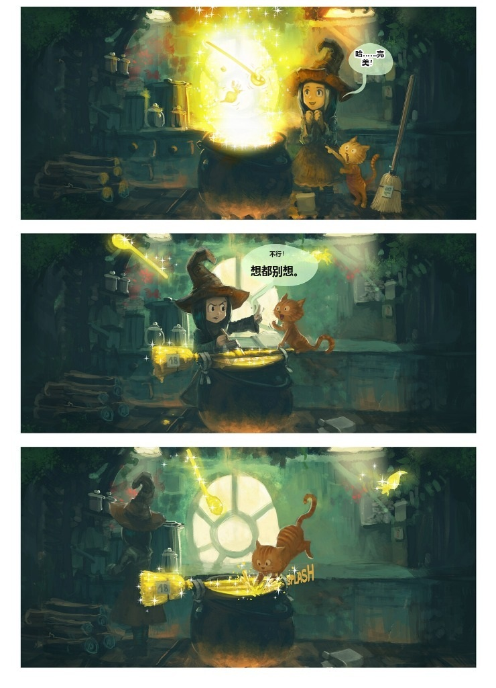
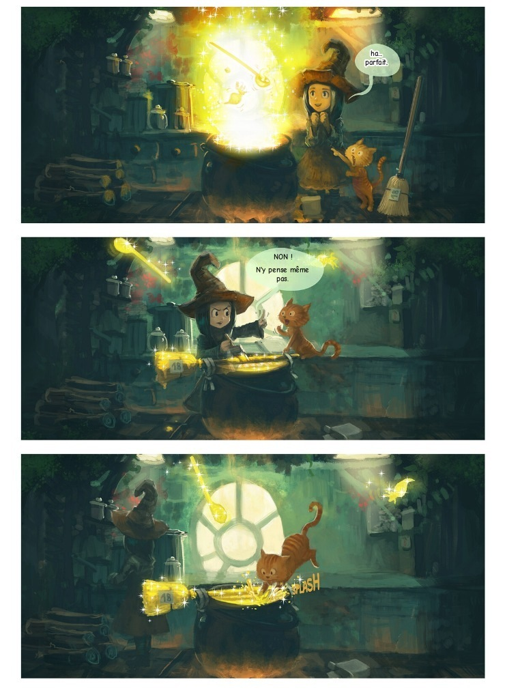
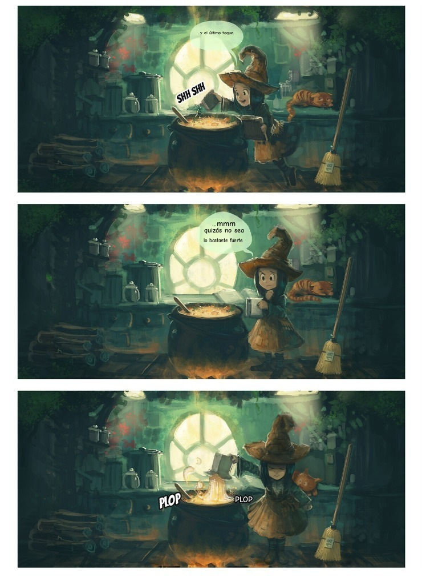

<div align="center">
  
  <h1>KomaWeave</h1>
  <p><strong>High-speed, GPU-accelerated Manga &amp; Manhwa Translation Server, CLI, and Workbench</strong></p>
  <p>
    <a href="LICENSE"></a>
    
    
    
  </p>
</div>

---

**KomaWeave** weaves together multilingual OCR, smart hybrid inpainting, context-aware translation, and manga-grade typesetting into a single modular server. It is built for single pages, ultra-long vertical webtoon strips, and full multi-page chapters—including speech bubbles split across consecutive image boundaries.

## Key Features

- **General-Purpose Multilingual OCR (`PP-OCRv6`)**: GPU-accelerated batched detection (`CUDAExecutionProvider` when available, automatic CPU fallback) + parallel recognition for vertical Japanese, English, Korean, Chinese, angled text, and clustered sound effects.
- **Smart Hybrid Text Removal**: Detects uniform speech bubbles for instant solid-color fill and routes complex artwork, gradients, and SFX to [`mayocream/aot-inpainting`](https://huggingface.co/mayocream/aot-inpainting) (FP16 on CUDA, FP32 on Apple MPS / CPU).
- **Cross-Boundary & Ultra-Long Strip Handling**:
  - Long vertical strips (`>2600 px`) are sliced at quiet horizontal gutters (`app/image_slicer.py`) without cutting through text.
  - Consolidated chapter batches stack consecutive same-width images before gutter-aware slicing, keeping speech bubbles spanning page seams intact for OCR, translation, and typesetting before splitting back to exact original heights.
- **Flexible Translation Backends**:
  - **Google Translate** built in for zero-config translation.
  - **Multi-Provider AI** (`OpenAI`, `Google Gemini`, `DeepSeek`, `Anthropic`, `Groq`, `OpenRouter`, and any `Custom OpenAI-Compatible` endpoint such as Ollama/vLLM) with live model discovery, local `.secrets.json` key storage, and token-efficient `{"t":[...]}` JSON batching.
- **Developer-First Modular Server & Lazy Loading**:
  - Request full translation (`mode=full`), text extraction only (`POST /api/ocr` or `mode=ocr`), or text removal only (`mode=clean`).
  - Swap OCR models (`auto` / `medium` / `tiny`), inpainting modes (`auto` / `solid_only` / `aot_only`), external `.ttf`/`.otf` fonts (`font_file` or `/api/fonts`), text colors, outlines, and output formats (`png` / `jpeg` / `webp`) per API call.
  - Configure `PRELOAD_MODELS=all|ocr|none` so only required assets are loaded into VRAM/RAM.
- **Manga-Grade Typesetting**: Full Arabic RTL shaping (`arabic-reshaper` + `python-bidi`) with bold manga/dialogue/SFX fonts and automatic black/white contrast + outline selection.

---

## Visual Showcase

### Multilingual Showcase (5 Languages)

<table>
  <tr>
    <th>English (Original)</th>
    <th>Arabic (العربية)</th>
    <th>Chinese (简体中文)</th>
    <th>Spanish (Español)</th>
    <th>French (Français)</th>
  </tr>
  <tr>
    <td></td>
    <td></td>
    <td></td>
    <td></td>
    <td></td>
  </tr>
  <tr>
    <td></td>
    <td></td>
    <td></td>
    <td></td>
    <td></td>
  </tr>
</table>

<sub>*Original English pages: Pepper&amp;Carrot Episode 1 ("The Potion of Flight") by David Revoy ([peppercarrot.com](https://www.peppercarrot.com)), licensed under [CC BY 4.0](https://creativecommons.org/licenses/by/4.0/). Translated into Arabic, Chinese Simplified, Spanish, and French with KomaWeave.*</sub>

---

## One-Command Setup

Requires **Python 3.10+**.

```bash
git clone https://github.com/ddccdcdc/KomaWeave.git
cd KomaWeave
python setup_project.py --venv
python run.py
```

These commands automatically:
1. Installs Microsoft Visual C++ Redistributable (`x64`) on Windows if missing, and creates a local `.venv` virtual environment (omit `--venv` to install into your active Python environment).
2. Detects your hardware (**NVIDIA CUDA**, **Apple Silicon MPS**, or **CPU**) and installs the matching `torch` and `onnxruntime-gpu` / `onnxruntime` builds plus all dependencies in `requirements.txt`.
3. Downloads the required manga and Arabic/multilingual fonts into `fonts/` and pre-caches the `PP-OCRv6` and `mayocream/aot-inpainting` model weights.
4. `python run.py` automatically enters `.venv` (and completes setup if skipped) and launches the server at **http://127.0.0.1:8000/**—no manual `activate` command required.

> Override hardware detection with `--device cuda`, `--device mps`, or `--device cpu`.

---

## Quick Start

### 1. Start the Web UI & API Server

```bash
python run.py
```

Open **http://127.0.0.1:8000/** in your browser, or expose on your network:

```bash
python run.py --host 0.0.0.0 --port 8000
```

### 2. Translate a Chapter via CLI

```bash
python translate_chapter.py path/to/chapter_folder --target ar
```

Key flags: `-o/--output`, `--source`, `--provider`, `--model`, `--api-key`, `--base-url`, `--no-consolidated`.

---

## HTTP API Reference

Interactive OpenAPI docs are available at **`/docs`** when the server is running.

### Core Endpoints
- `GET /api/health` — Server readiness, active device (`NVIDIA ...`, `Apple MPS`, or `CPU`), `ocr_loaded`, `aot_loaded`, and `ocr_cuda`.
- `GET /api/fonts` & `POST /api/fonts` — List or upload reusable `.ttf`/`.otf` fonts.
- `GET /api/providers` & `POST /api/providers/{id}/models` — Manage AI providers and discover live models.

### `POST /api/ocr`
Extracts text blocks only (skips translation, inpainting, and typesetting) for 1 or more images (`multipart/form-data`).
- `files`: One or more image files
- `consolidated` (default `true`): Stacks consecutive same-width images so cross-boundary speech bubbles are extracted intact.
- `ocr_model`: `auto` | `medium` | `tiny`

### `POST /api/translate` & `POST /api/translate-batch`
Translates a single page (`file`) or consolidated chapter batch (`files`, `consolidated=true`) with full per-request control:
- `target_lang` (default `ar`), `source_lang` (default `auto`)
- `provider` (default `google_free`), optional `model`, `api_key`, `base_url`
- `mode`: `full` (default) | `ocr` (text extraction only) | `clean` (OCR + text removal only)
- `ocr_model`: `auto` | `medium` | `tiny`
- `inpaint_mode`: `auto` | `solid_only` | `aot_only`
- `font_name` (registered font) or `font_file` (external `.ttf`/`.otf` upload), `font_scale` (`0.4–2.5`), `text_color` (`auto` or `#RRGGBB`), `outline_enabled` (`true`/`false`)
- `output_format`: `auto` | `png` | `jpeg` | `webp`, `output_quality` (`50–100`)

Example Python client:

```python
import httpx

files = [
    ("files", ("001.jpg", open("001.jpg", "rb"), "image/jpeg")),
    ("files", ("002.jpg", open("002.jpg", "rb"), "image/jpeg")),
]
resp = httpx.post(
    "http://127.0.0.1:8000/api/translate-batch",
    files=files,
    data={"target_lang": "ar", "consolidated": "true", "inpaint_mode": "auto"},
    timeout=120,
)
data = resp.json()
print("Total time (s):", data["chapter_timings_s"]["total"])
```

---

## Hardware Support

| Hardware | OCR Detection | AOT-GAN Inpainting | Notes |
| --- | --- | --- | --- |
| **NVIDIA GPU (CUDA)** | `CUDAExecutionProvider` | CUDA (FP16) | Fastest mode; auto-selected when `nvidia-smi` is detected |
| **Apple Silicon (M1–M4)** | CPU | MPS (FP32) | Auto-selected on macOS `arm64` |
| **CPU (x86_64 / ARM64)** | CPU | CPU (FP32) | Works out of the box without a GPU |

## GPU Performance Benchmarks

Measured on **NVIDIA GeForce RTX 2080 SUPER** (warmed pipeline, CUDA FP16 inpainting, `CUDAExecutionProvider` OCR, Google Translate):

| Workload | Settings / Features Enabled | Total Time | Average / Page | Breakdown |
| --- | --- | --- | --- | --- |
| **167-Page Chapter Batch** (`800×1280`, 179 text blocks) | `consolidated=True`, cross-boundary gutter slicing, batched GPU `PP-OCRv6_det_tiny` (`800×800`) + parallel CPU `Rec`, smart solid-fill + `aot-inpainting` FP16 (in parallel with translation), 8-thread Pillow render | **22.83 s** | **0.137 s / page** | OCR: `8.90 s` (`0.053 s/img`) · Translate: `3.06 s` (parallel) · Inpaint: `9.60 s` · Render: `3.46 s` · Disk write: `0.13 s` |
| **Single Webcomic Page** (`740×1024`, 3 blocks) | `ocr_model="auto"` (`PP-OCRv6_det_medium` `1280×1280`), `inpaint_mode="auto"`, Google Translate | **0.392 s** | **0.392 s** | OCR: `0.191 s` · Inpaint: `0.181 s` · Translate: `0.156 s` (parallel) · Render: `0.020 s` |
| **Single Manhwa Page** (`800×1280`, 1 block, cold AOT shape) | `ocr_model="auto"` (`PP-OCRv6_det_medium` `1280×1280`), `inpaint_mode="auto"`, Google Translate | **3.674 s** | **3.674 s** | OCR: `0.230 s` · Inpaint: `3.412 s` · Translate: `2.589 s` (parallel) · Render: `0.031 s` |

---

## Configuration & Security

- **API Authentication:** Set `KOMAWEAVE_API_KEY` to require `X-API-Key` or `Authorization: Bearer <token>` on all `/api/*` endpoints (except `/api/health`). When binding to a non-loopback host (`--host 0.0.0.0`) without `KOMAWEAVE_API_KEY`, `run.py` automatically generates and prints a 32-byte session API key (override with `--allow-unauthenticated` only on trusted isolated networks).
- **SSRF Protection:** Custom provider `base_url` endpoints reject loopback, private, link-local, and cloud metadata IPs (`169.254.169.254`) and disable HTTP redirects. To allow a local Ollama/vLLM server (`localhost` / `127.0.0.1`), set `KOMAWEAVE_ALLOW_LOCAL_PROVIDERS=1`.
- **Upload, Pixel & Concurrency Limits:** Streaming chunked reads cap single files (`MAX_UPLOAD_MB=25`), aggregate batch payload (`MAX_BATCH_TOTAL_MB=250`), image dimensions/pixels (`MAX_IMAGE_WIDTH=8192`, `MAX_IMAGE_HEIGHT=16384`, `MAX_IMAGE_PIXELS=40000000`), per-IP rate limits, request timeout (`REQUEST_TIMEOUT_SECONDS=300`), and concurrent GPU jobs (`MAX_CONCURRENT_GPU_JOBS=2`).
- **Secrets Storage:** Saved AI provider API keys are stored locally in `.secrets.json` (git-ignored, `0600` permissions on POSIX) and are never returned unmasked by `/api/providers`.

---

## Privacy & Data Handling

- OCR, inpainting, and typesetting run **100% locally**; images are processed in memory and are **not** stored on disk by the HTTP API or sent to translation providers.
- When translating with `google_free` (default) or a cloud AI provider, **extracted text** is sent to that third-party service (`google_free` uses Google Translate's public web endpoint, not the Google Cloud Translation API).
- For confidential or unpublished manuscripts, use a local LLM (`KOMAWEAVE_ALLOW_LOCAL_PROVIDERS=1`) or OCR-only mode (`POST /api/ocr`). See [PRIVACY.md](PRIVACY.md) for full details.

---

## License & Attributions

- **KomaWeave** is licensed under the **GNU Affero General Public License v3.0 (AGPL-3.0)** ([LICENSE](LICENSE))—anyone modifying or running a modified version as a network service must release their source code under AGPL-3.0.
- Model weight provenance and licenses are documented in [MODEL_LICENSES.md](MODEL_LICENSES.md).
- Third-party libraries, fonts, and UI asset licenses are listed in [THIRD_PARTY_LICENSES.md](THIRD_PARTY_LICENSES.md).
